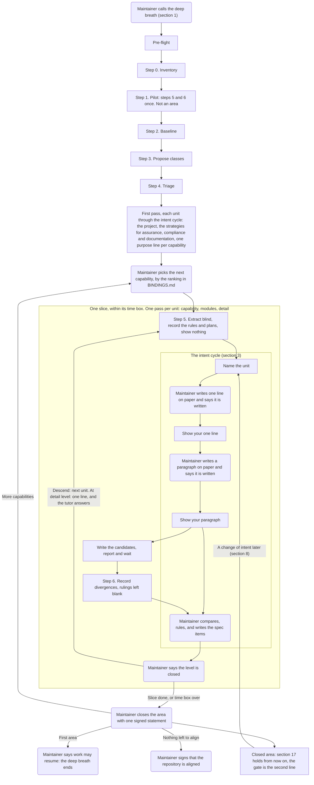

# method/process.md

Part of Kowloon, the method of `ALIGNMENT.md`. Read it before you take any step of the alignment process, or write a report, a candidate, a divergence, a finding, a delta or a lesson.

## 7. The alignment process

Work one step at a time. Each step ends with a report and a wait for the maintainer.

The drawing is informative; the text below it is the rule. Rounded boxes are the maintainer's or the tutor's; square boxes are yours.



### The deep breath

Section 1 of `ALIGNMENT.md` is the rule. These are its records.

- **The list.** `alignment/in-flight.md` has one line per unfinished item, with its branch, its files, its capability and its state: uncommitted; committed, not pushed; pushed, no pull request; pull request open; complete, awaiting a gate or a merge; parked. Where one item depends on another, the line says so.
- **Running jobs.** A build, gate or sweep that was already running may end. Record its result. Start no other, and open or merge nothing on the strength of it.
- **Other machines.** The deep breath covers every session on every machine. A session that relays it says whose instruction it relays; a session that receives a relayed deep breath confirms it with its own user. The list records each machine as confirmed or not.
- **Open issues.** They are frozen under the hold label. A frozen issue is evidence for the extraction, not a work item. Nothing is closed. A finding made during alignment is recorded under `alignment/`, not filed.

### Pre-flight

Check each of these and report what you find. Fix none of them yourself.

- Whether the maintainer has a signing key, and whether the key registry of section 10 exists and lists it.
- Whether a key or an agent the session can reach would sign.
- Whether the repository's commit hooks accept a commit that holds only prose. The first commit under `alignment/` is the test; a hook is changed only on the maintainer's instruction.
- How a blind session is started here: one that loads neither the instruction files nor the memory, and writes no memory. Extraction needs it. A candidate: a clean account, and a checkout that leaves the instruction files out. Until it is settled, every extraction report says so.

### Step 0. Inventory (read-only)

Produce `alignment/inventory.md`: the top-level layout; every agent instruction and context source, including those outside the repository, with where they live; every prose location; where tests, checks, compliance evidence and documents live, and any text that states a strategy for them; and the external references the code depends on. Verify everything against the actual files.

### Step 1. Pilot

Run steps 5 and 6 once, on the pilot named in `BINDINGS.md`, to find out whether the method holds before the rest is committed to. The pilot is marked as one in `alignment/status.md`. It is not an area, and closing it does not end the deep breath. Alignment proper proceeds from the project level down; a pilot may start with the most mechanical part.

### Step 2. Baseline

Where and when the maintainer says: run the existing tests and checks as they are, without changing them, and write each check's status to `alignment/baseline.md`, including checks that already fail. Run twice; a check whose result differs is marked flaky. A check that is statistical by design is a budget: a pass rate over a stated number of runs, with seeds and versions pinned, never rerun to pass. Record the budget measurements here once budgets exist. No change to source is made before the baseline exists, except a fix under the wrong-result exception of section 1.

### Step 3. Propose classes

Draft `alignment/proposed.gitattributes`: a `class` for every tracked path, and `intent=unassigned` for every derived path. List every path whose class is not obvious, with the reason, in `alignment/class-questions.md`.

### Step 4. Triage

Read-only tasks, each returning a short table under `alignment/triage/`:

1. Every interface capability, with its inputs, outputs and outcomes, and where interfaces differ.
2. What each capability reaches, taken from tooling and not from judgement.
3. Per module: whether it is on a path that can change a result, parses external input, is safety- or security-relevant; its churn; its share of agent-assisted commits.
4. Duplication.
5. Behaviour no capability asks for.
6. Experiment candidates: feature flags, names such as unstable or prototype, hidden commands, code reachable only behind a flag, recent churn with thin tests. Recently touched and unreachable suggests an experiment; old and unreachable suggests dead code.
7. Which checks exist, and whether each can fail.

From these, record the unexplained findings and the possibly unreachable ones (section 4). Tasks 2 and 4 are run again for each release report (section 11).

Do the cheap tasks first: 1, 3, 6 and 7 need only git, search and the test runner. Task 2 is approximate: test coverage shows what a capability's tests reach, not all that is reachable. Showing that a check can fail is costly, so it is sampled. Every table is a proposal for the maintainer, never a classification.

### Step 5. Extract a slice

Alignment proceeds by interface capability, from the project level down: project, capability, modules.

**Order of traversal.**

- **Two passes.** First, across everything: the project item, the strategies where they exist (section 3), and one `purpose` line per capability, before going deep anywhere. Then one capability at a time.
- **Direction.** Confirmation runs from the top down. Evidence is gathered from the code up.
- **Which capability next.** By the ranking in `BINDINGS.md`.
- **Cost of checks.** It decides when work is affordable, not the order: the cheapest to check suits a pilot, and a heavy suite waits for the machine that can run it.
- **Within a slice.** The interface boundary first, then the modules on a path that can change a result, then the rest.
- **Shared modules.** Aligned once, by the first slice that reaches them. Later slices add links and checks.
- **Stopping.** Each slice has a time box, set in `BINDINGS.md`. A slice may close with its open divergences listed.

At each level, for the current slice only:

1. Name the unit under alignment: its level and what it is. This opens the intent cycle of section 3.
2. In a fresh, blind session, extract candidate intent from the artifacts at that level: what the code does, what it assumes about its environment, what it promises to callers. Show none of it yet.
3. Record the status-quo rules and plan items that concern this area as candidates too: quote each exactly, cite file and line, flag rules that conflict with each other or with the code. Do not judge them and do not propose removals.
4. Run the paper rounds of the intent cycle. Your line and your paragraph come from the extraction.
5. Write the candidates to `alignment/candidates/<level>-<slice>.md`, opening with your line and your paragraph, both labelled as inference.
6. Report and wait. The maintainer compares your line, your paragraph and the candidates with what is on the paper, and returns the differences, which you record as divergences.
7. The level is closed when the maintainer has ruled on those differences, has written the unit's spec items, and says "closed". Descend only then.

Continue to detail level only for files, types and functions that need a check the module item cannot anchor: those that carry a property, or are safety- or security-relevant. There the cycle is shorter (section 3): one line on paper, no paragraph, and the tutor answers what the unit is for.

Rules for extraction:

- Describe behaviour you can point to. Cite file and line for every candidate.
- Separate what the code does from what you think it is for. Label the second as inference.
- Keep the source of each candidate distinct. Code behaviour carries the most weight; rules, memory, plans, prose, comments and issues are supporting evidence.
- Where two interfaces expose the same capability differently, record the difference. Do not reconcile it.
- Where prose, memory or a rule disagrees with the code, record both sides. Correct neither.
- Where a frozen issue disputes a behaviour you describe, cite it in `conflicts`.
- Record every environment assumption, with the behaviour it excludes.

### Step 6. Record divergences

When the maintainer returns a comparison, draft one entry per difference in `alignment/divergences/`. Leave classification and decision blank unless the maintainer has stated them. Where a divergence could be resolved by changing the spec, draft that change under `alignment/deltas/` in the delta format of section 12 and name it in the entry, even if you think the code is wrong. Each frozen issue cited at that level is linked from a divergence entry or listed as "not a divergence". The maintainer closes issues.

### Plans and unfinished work

- **Plans.** This is the rule for plans; other files point here. A plan item gains force only when the maintainer restates it as a spec item, and for something not yet built, only when work on it is about to start. Every plan is treated as agent-written unless the maintainer says otherwise. That the maintainer's text or the code agrees with a plan is not confirmation. No list of parked items is kept. Where plans live outside the repository, the blind session is given the ones that concern its slice.
- **Unfinished work.** A line of `alignment/in-flight.md` is ruled on when its capability is traversed: named for removal (section 2 decides when), or re-entered after the area closes as a requested change (section 8) or as an experiment (section 9), with the branch as reference only. Unruled lines stay paused. The capability on each line informs the maintainer's choice of what to traverse next; it does not change the order.
- **The roadmap afterwards.** It is the release report's unserved items plus the open deltas. It is short on purpose: longer-range direction lives in `purpose` items and in informative plans.

### Reports and progress

A report gives: what was written, with counts by source; open questions for the maintainer; and anything you could not explain. "Unknown" is a valid finding; do not invent a purpose.

`alignment/status.md` is the record of where the process stands: one row per step, and per slice and level, with its state (not started, extracted, intent written, compared, closed), the candidate count, the open divergences, and the commit that closed it. Update the row in the same commit as the step's output. When a slice closes, its rows collapse to one line with the closing commit.

### Closing an area

Only the maintainer closes an area, when its slice is done, with one signed closing statement. Closing the first area lets the maintainer end the deep breath (section 1).

- **Rules.** The statement names each status-quo rule that is confirmed into `spec/` or retired. A rule it does not name is kept. The instruction files come into line the same way: confirmed intent moves to `spec/` and leaves a pointer, retired text is removed, rules about how agents work stay.
- **Files.** A file it does not name must link to an item, or it is reported as unassigned.
- **Strategies.** For each strategy the statement says "rules written" or "none". Rules written here bind this area (section 3).
- **Tests.** Tests recorded as vacuous or fitted to the implementation are ruled on in the same statement.
- **Removals.** A removal named in the statement needs no further ruling. An unreachable finding is confirmed by removing the code and running the linked checks; if one fails, it was reachable after all.
- **Records end here.** Closing deletes the slice's candidates, deltas, closed divergences and any task list left over; git keeps them. Closing the first area also deletes the first-pass candidates for the project and the strategies. Triage tables are replaced by each release report. Open divergences stay. The slice's lines in `alignment/read-checks.md` collapse to one.

Act only on what the statement says.

## 12. Formats

Candidate intent:

```
id: CAND-<level>-<nnn>
level: project | capability | module | detail
slice: <slice name> | strategy-<name> | general
statement: <one sentence: what must be true, or the rule quoted exactly>
kind: behaviour | constraint | budget | assumption | working-rule
source: code | instruction-file | memory | log | plan | prose | comment | issue
evidence: <path:line>, <path:line>
basis: observed | inferred
human-only: yes   (only when git history shows the rule came from a commit with no agent involvement; otherwise omit the line)
conflicts: <other evidence that disagrees, or none>
question: <what the maintainer needs to answer, or none>
```

Divergence:

```
id: DIV-<nnn>
level: project | capability | module | detail
unit: <path or symbol>
extracted: <what the code does>
confirmed: <what the maintainer stated, quoted>
issues: <tracker numbers that report this difference, or none>
proposed-delta: <path under alignment/deltas/, or none>
classification: <blank until the maintainer decides>
decision: <blank until the maintainer decides>
status: open
```

Finding:

```
id: FIND-<nnn>
finding: unexplained | possibly-unreachable | unreachable
unit: <path or symbol, or the interfaces or documents that disagree>
evidence: <path:line, or the triage table and row>
question: <what the maintainer needs to answer>   asked: <YYYY-MM-DD>
exit: <blank> | item <spec id> | experiment <spec id> | removed in <closing statement or release report>
```

Proposed delta:

```
delta: <DIV id, or the unit of a requested change>
ADDED      <one line: what a new item would have to cover, and why>
MODIFIED   <spec id>@<signed version>   <one line: what would differ, and whether section 3 requires a version bump>
REMOVED    <spec id>@<signed version>   <one line: why>
```

- One file per divergence or requested change. It holds only what would differ; it never restates the spec and never words an item.
- Each entry names the item at its signed version. A delta that names any other version is out of date and is redrafted.
- An id never changes, so there is no entry for renaming.
- The delta is a proposal. The maintainer runs the intent cycle of section 3 for its unit, writes the change under `spec/`, and signs.

Method lesson:

```
id: LES-<nnn>
date: <YYYY-MM-DD>
scope: portable | project
happened: <what occurred>
proposal: <the change to the method>
maintainer: <the maintainer's words, quoted, or —>
status: proposed | decided | adopted in <version> | rejected — <reason>
```

## 14. Method lessons

- **What is recorded.** Only something that would change the method: two rules conflicted; a step needed something outside `alignment/`; the maintainer decided something the method does not cover; a format lacked a field; a workaround was used.
- **When.** At the end of a step, with the step's report: append each lesson to `alignment/lessons.md` as `proposed`, quoting the maintainer's words where it came from a decision. The maintainer confirms them in one batch. A lesson is deleted once a signed version of the method carries it. A rejected lesson keeps its id and one line of reason, so it is not proposed again.
- **A lesson is about the method, never about the product.** Something that reads like the project's intent is a candidate.
- **A lesson has no force until the method carries it and the maintainer signs.**
- **A new obligation enters only this way.**
- **Files stay short.** Each file of the method has a word cap (section 11); to add, something else is shortened or removed, or the maintainer raises the cap.
